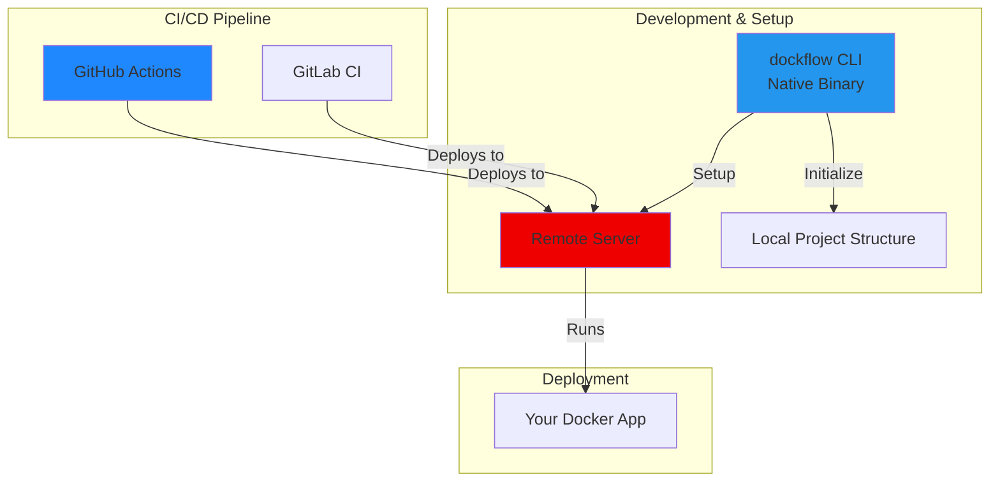

# Contributing Guide

Welcome! Contributions are appreciated. Open an issue or pull request to suggest features or improvements.

## Architecture Overview

Dockflow uses a native CLI binary for all operations:



| Component | Purpose | Description |
|-----------|---------|-------------|
| **dockflow CLI** | Setup, build, deploy & management | Native binary (Linux, macOS, Windows) |

---

## Before Contributing

Run the checks of the CLI and the e2e suites that cover your change: see the [Developer Guide](./DEVELOPERS.md).

```bash
cd cli
bun run typecheck && bunx biome check src && bun test
```

---

## Building CLI Binaries

The CLI is built as a native binary with Bun. The `cli/` directory holds the TypeScript source.

### Prerequisites

- [Bun](https://bun.sh), at the version pinned in `.bun-version`

### Build Commands

```bash
cd cli

# Install dependencies
bun install

# Build all platform binaries
bun run build

# Build for a specific platform
bun run build linux-x64
```

### Output

Binaries are generated in `cli/dist/`:

| Binary | Platform |
|--------|----------|
| `dockflow-linux-x64` | Linux (x64) |
| `dockflow-linux-arm64` | Linux (ARM64) |
| `dockflow-windows-x64.exe` | Windows (x64) |
| `dockflow-macos-x64` | macOS (Intel) |
| `dockflow-macos-arm64` | macOS (Apple Silicon) |

### Development

Run the CLI without compilation:

```bash
bun ./cli/src/index.ts --help
```

#### Running your local Dockflow on a project

`cli/scripts/dev.ts` runs the CLI from source in the current directory, with the arguments you give it:

```bash
cd /path/to/my-app
bun /path/to/dockflow/cli/scripts/dev.ts deploy production
```

**Recommended: create an alias**

```bash
# Bash/Linux/macOS - Add to ~/.bashrc or ~/.zshrc
alias dockflow-dev='bun /path/to/dockflow/cli/scripts/dev.ts'
```

```powershell
# PowerShell/Windows - Add to $PROFILE
function dockflow-dev { bun C:\path\to\dockflow\cli\scripts\dev.ts @args }
```

Then use it like the regular CLI:

```bash
dockflow-dev deploy production
dockflow-dev build production
dockflow-dev ssh production "docker ps"
```

---

## Releasing

A release is a Git tag: its name is the version. Nothing is bumped by hand, the release workflow
writes the version into the packages it publishes.

```bash
git tag -a X.Y.Z -m "Dockflow X.Y.Z"
git push origin X.Y.Z
```

`publish-cli.yml` then builds every binary, runs the CLI checks and the setup e2e suite on the built
binary, and only if they pass publishes the GitHub Release (binaries and `SHA256SUMS`), the npm
package `@dockflow-tools/cli`, and the docs. A tag such as `X.Y.Z-dev1` is a prerelease: npm
publishes it under the `dev` tag, so installs keep the latest stable version.

The MCP server is released the same way with a tag `mcp-X.Y.Z` (`publish-mcp.yml`).

---

## Cleaning Up Dev Tags

To delete all development tags for a specific version:

```bash
node scripts/delete-dev-tags.js 1.0.48
```

This removes all `1.0.48-dev*` tags locally and remotely.

---

## License

Contributions are licensed under the [MIT License](./LICENSE).